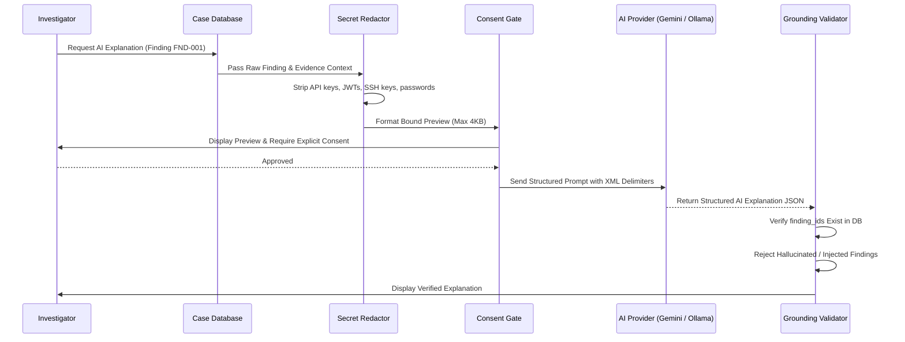

# BHARYDANGEROUS-Investigator — Threat Model & Security Architecture

**Author:** Ashim  
**Product:** BHARYDANGEROUS-Investigator (`bdinvestigator`)  
**Scope:** Forensic Execution Environment, Evidence Handling, and AI Integration  

---

## 1. Executive Security Principles

BHARYDANGEROUS-Investigator is engineered for forensic incident response in adversarial environments where target evidence may contain active exploits, zip bombs, poisoned log entries, and malicious prompt injections. The application adheres to five core security tenets:

1. **Evidence Integrity:** Source evidence is strictly read-only and never modified or overwritten.
2. **Subprocess Isolation:** All external forensic tools are executed using rigid argument arrays with timeouts and bounded output buffers; `shell=True` is categorically forbidden.
3. **Archive & File Quota Enforcement:** Decompression operations enforce strict limits on nesting depth, uncompressed size, compression ratios, and directory traversal attempts.
4. **Adversarial Prompt Shielding:** Evidence text transmitted to Large Language Models is pre-sanitized, secret-redacted, delimited, and validated against known deterministic finding IDs.
5. **Deterministic Independence:** Core DFIR capabilities are 100% functional without external network connectivity or AI provider credentials.

---

## 2. Evidence Intake & Custody Boundaries

| Threat | Mitigation | Implementation |
|---|---|---|
| Evidence tampering / modification | Read-only permissions set upon registration; hashing performed via read-only file streams | `src/bharydangerous/core/hashing.py` |
| Hash collision / spoofing | Dual hashing with SHA-256 (mandatory) and MD5 (legacy cross-reference) | `src/bharydangerous/core/hashing.py` |
| Unaudited custody changes | Cryptographically hashed chain-of-custody ledger in SQLite DB | `src/bharydangerous/db/repositories.py` |
| Database corruption | SQLite WAL (Write-Ahead Logging) mode and mandatory foreign key checks (`PRAGMA foreign_keys = ON`) | `src/bharydangerous/db/connection.py` |

---

## 3. Subprocess Execution & Command Injection Defenses

BHARYDANGEROUS-Investigator frequently interfaces with system forensic binaries such as `fls`, `mmls`, `volatility`, and `tshark`.

```mermaid
graph TD
    CLI[User CLI Invocation] --> SAN[Argument Validator & Array Builder]
    SAN --> SUB[SafeSubprocessRunner]
    SUB --> PIPE[Process Pipes (stdout / stderr)]
    PIPE --> TIMEOUT{Timeout / Buffer Guard}
    TIMEOUT -->|Exceeded 10MB or 300s| KILL[Process Killed / Bounded Buffer Returned]
    TIMEOUT -->|Normal Exit| PARSE[Deterministic Output Parser]
```

### Defense Specifications:
- **No Shell Interpolation:** Python's `subprocess.Popen` / `subprocess.run` is invoked strictly with `shell=False` and a `List[str]` argument array. No evidence metadata or user-controlled string is ever concatenated into a shell command line.
- **Resource Constraints:** Subprocesses are bounded by default timeouts (e.g. 120s to 300s) and stdout/stderr capture caps (10 MB buffer limit) to prevent memory exhaustion from verbose or malicious binaries.
- **Controlled Working Directory:** Subprocess working directories are restricted to an isolated temporary scratchpad, preventing binary planting or relative path hijacking.

---

## 4. Archive Decompression & Zip Bomb Protection

Malicious archives designed to crash forensic analyzers are neutralized by `ArchiveInspector`:

- **Maximum Uncompressed Size:** 500 MB per archive session.
- **Maximum Compression Ratio:** 100:1 limit. Any file whose uncompressed-to-compressed ratio exceeds 100 is flagged as an archive bomb and aborted.
- **Maximum Archive Depth:** 3 levels of recursive nesting.
- **Path Traversal Shield:** Archive member file paths containing directory traversal tokens (such as `../`, `..\`, absolute root paths, or control characters) are stripped and sanitized using `os.path.normpath` and strict safe subpath validation.

---

## 5. AI Reasoning & Adversarial Shielding

When AI capabilities (`gemini-2.5-flash` or local Ollama) are invoked, all evidence excerpts pass through an adversarial defense pipeline.



### Adversarial Defenses:
1. **Automated Secret Redaction:** Regex-based scrubbing strips GCP/OpenAI/AWS API keys, private keys (`BEGIN RSA PRIVATE KEY`), JWTs, Bearer tokens, and database passwords before user preview or network transmission.
2. **Explicit Consent & Bounded Excerpts:** The investigator must review a sanitized preview of evidence text (capped at 4,096 characters) and explicitly approve transmission. In non-interactive/CI modes, `--consent` must be passed explicitly.
3. **XML Delimiter Isolation:** Evidence text is enclosed in strict `<evidence_context>` and `<finding_data>` blocks, instruct-hardened against instruction override attacks.
4. **Strict Grounding Validation:** The AI response must return referenced `finding_ids`. The `GroundingValidator` cross-references these IDs against genuine finding records in the SQLite database. Any reference to non-existent finding IDs causes the finding reference to be flagged or discarded, preventing hallucinated conclusions.

---

## 6. Offline Operational Guarantees

BHARYDANGEROUS-Investigator provides complete digital forensics workflows without network connectivity:
- Hashing, triage, and EVTX/syslog/web log parsing run 100% locally.
- Disk partition extraction uses pure-Python MBR/GPT parsers when The Sleuth Kit is not installed.
- Memory triage uses native string and PE header carving when Volatility 3 is not available.
- Network PCAP analysis parses raw Ethernet, IPv4, TCP, UDP, DNS, and HTTP packets using pure-Python binary unpackers when TShark is absent.
- YARA scanning falls back to built-in compiled regex pattern matching when `yara-python` is not installed.
- The `mock` AI provider allows full end-to-end testing and offline simulation of AI reporting workflows.
